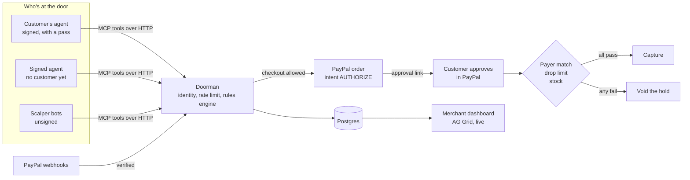

# Doorman

**Know Your Agent for PayPal merchants.** Doorman lets real customers' AI agents shop a store, keeps scalper bots out of limited drops, and ends every agent purchase with the customer approving the payment in PayPal.

Built for the [PayPal AI Hackathon](https://paypalaihackathon.devpost.com/), November 2026.

**Live demo: https://doorman-ppw2.onrender.com** (PayPal sandbox, no real money)

## Try it (about 5 minutes)

The demo runs on PayPal's sandbox. Whenever PayPal asks you to log in, use this sandbox buyer account:

| | |
|---|---|
| Email | `sb-nizs553636398@personal.example.com` |
| Password | `testsandbox1` |

It's a test account with play money. Use a private or incognito window so your own PayPal login doesn't get in the way.

The merchant side (**Dashboard**, **Rules**, **Settings**) asks for the merchant password. It's in the testing instructions of the Devpost submission. Customer pages don't need it.

1. **Give an AI agent a pass, as the customer.** Open the [storefront](https://doorman-ppw2.onrender.com/store) and click **Let my AI assistant buy it**. Log in with PayPal using the sandbox account, so PayPal confirms you're a real, verified person. Choose **Ava**, set a spending cap and how long the pass lasts, and click **Create pass**. (If the store already offers **Ask Ava to buy it**, someone linked her earlier; use **Link an agent** in the top bar to give her a fresh pass.)
2. **Run a limited drop, as the merchant.** Open the [dashboard](https://doorman-ppw2.onrender.com/dashboard) and click **Run the drop**. A 50-hoodie drop opens, and for about a minute and a half dozens of scalper bots and three AI agents hit the store:
   - Unsigned bots can browse but not buy, and the swarm gets throttled.
   - Juniper's revoked pass is refused.
   - Kestrel signs its requests but has no customer linked, so the customer would have to step up and confirm.
   - Ava, driven by Gemini, shops with the pass you just gave her. She asks for two hoodies, is told the limit is one, and adapts.
3. **See why.** Click any row in the live traffic table for the checks Doorman ran and a plain-English explanation of the decision. For orders, the panel also shows the PayPal IDs and the webhook events PayPal sent.
4. **Approve Ava's purchase, as the customer.** Open the approval link in **Ava's conversation**, or go back to the store and click **Review and approve**. Click **Pay with PayPal** and approve with the same sandbox account. Doorman holds the money, checks that the person paying is the one who gave Ava her pass and that the drop limit holds, and only then charges.
5. **Try to buy a second one.** On the store, the drop now shows **You've got yours**, and if Ava is asked again Doorman stops her: one per customer.
6. **Change the rules.** On **Rules**, write a rule in plain English, for example *"Two hoodies per customer, and block unknown bots completely."* Gemini turns it into exact settings, and nothing changes until you review and save them.

Good to know:

- The demo and the sandbox account are shared. If the store already says **You've got yours**, someone else used the account in this drop: click **Run the drop** (or **Run it again**) for a fresh one.
- Approval links expire after 15 minutes.
- PayPal's sandbox checkout window can take 10 to 30 seconds to load the first time.
- Static Supply is a made-up store.

## Why Doorman

AI agents are starting to shop for people, and merchants can't tell a customer's assistant from a scalper bot: both are software hitting the store. Block every bot and you shut out real customers' agents. Let them all in and your limited drop goes to scalpers.

Doorman sits at the store's door and answers two questions for every request: **which agent is this, and what did a real customer allow it to do?** The customer stays in control of the money: no agent purchase is charged until they approve it in PayPal.

## How it works

Every visitor is in one of three tiers:

| Tier | What Doorman knows | Default treatment |
|---|---|---|
| **Unknown** | Nothing: unsigned traffic. | Can browse, can't buy. |
| **Signed** | Which agent it is. The agent signs every request with a key registered with the store ([RFC 9421](https://www.rfc-editor.org/rfc/rfc9421) HTTP Message Signatures, Ed25519, Web Bot Auth style). | Can buy only if the customer steps up and confirms. |
| **Verified** | Whose agent it is. The agent also carries a pass that a real customer issued after logging in with PayPal, with a spending cap and an expiry. | Can buy within the cap and the drop limit. |

A rules engine gives every request one of four decisions: **allowed**, **step up**, **throttled** or **blocked**, with the reason and the checks behind it. The engine is plain code, so the same input always gets the same answer. AI never makes the decision.

When an agent checks out, Doorman creates a PayPal order with intent `AUTHORIZE` and sends back an approval link for the customer. After the customer approves in PayPal, Doorman holds the money and checks three things:

1. **Payer match.** The PayPal account that paid must be the one that issued the agent's pass.
2. **Drop limit.** The per-customer limit is counted on the PayPal account that actually paid.
3. **Stock.** There must still be a hoodie left.

If all three pass, Doorman captures the payment. If any fails, it voids the hold and says why.



## PayPal APIs

| API | What Doorman uses it for |
|---|---|
| **Orders v2**: create with intent `AUTHORIZE`, then authorize | Every purchase is held first, so Doorman can check who paid before taking any money. |
| **Payments v2**: capture or void an authorization | Charge when every check passes; release the hold when one fails. |
| **Log in with PayPal** (OpenID Connect, with the `paypalattributes` scope) | Customers prove who they are before giving an agent a pass. Doorman records their payer ID and whether PayPal has verified them. |
| **JavaScript SDK v6** (one-time payment session, `<paypal-button>`) | The PayPal button on the approval page and in the cart. |
| **Webhooks**: register, then verify every signature | The server registers its own webhook and asks PayPal to verify each delivery before acting on it. If a customer approves but closes the page, `CHECKOUT.ORDER.APPROVED` lets Doorman finish the order anyway. Capture, void and denial events keep Doorman's orders in line with PayPal. |
| **Identity userinfo** | Shows which PayPal business account the store is connected to. |
| **`PayPal-Request-Id`** | Sent when creating, authorizing, capturing and voiding, so a retry can never charge twice. |

## AI

Doorman uses AI where language helps and keeps it out of the decisions.

| Where | What it does | Model |
|---|---|---|
| **Rule writer** ([`ai/rules.ts`](apps/server/src/ai/rules.ts)) | Turns the merchant's plain-English rules into exact, typed settings. The merchant reviews them before saving, and anything the settings can't express is listed instead of silently dropped. | Gemini 3.5 Flash |
| **"Why Doorman did this"** ([`ai/explain.ts`](apps/server/src/ai/explain.ts)) | A short explanation of one decision, written only from the recorded facts. | Gemini 3.5 Flash-Lite |
| **Ava**, the demo shopping agent ([`sim/ava-ai.ts`](apps/server/src/sim/ava-ai.ts)) | A real AI agent: Gemini decides each step and acts only through the store's MCP tools, so Doorman judges her like any other agent. | Gemini 3.5 Flash-Lite |

Gemini is called through the [Vercel AI SDK](https://ai-sdk.dev/). The store's agent interface is a [Model Context Protocol](https://modelcontextprotocol.io/) server, built with the official TypeScript SDK.

**AI tools used to build Doorman:** the code was written with Claude Code (Anthropic) as the coding assistant, and the screens were designed in Claude Design.

## Connect your own agent

Any agent can shop the store through Doorman. [`sim/agent-client.ts`](apps/server/src/sim/agent-client.ts) is a complete reference client, and `npm run demo:agent` visits the store three ways and prints how Doorman answered each one.

1. **Register a key.** `POST /agents/register` with `{ "name", "operator", "publicKey" }`, where `publicKey` is an Ed25519 public JWK. The response gives your key ID (the key's JWK thumbprint).
2. **Sign every request** following RFC 9421. Cover `("@method" "@authority" "@path" "content-digest")` and set `alg="ed25519"`, `keyid`, `tag="web-bot-auth"`, `created`, `expires` (5 minutes at most) and a `nonce`. Doorman refuses a replayed nonce.
3. **Use the MCP endpoint** at `POST /mcp` (Streamable HTTP). It has six tools: `search_products`, `add_to_cart`, `checkout`, `order_status`, `request_customer_link` and `collect_agent_pass`.
4. **Get a pass.** `request_customer_link` returns a link for your customer. Once they log in with PayPal and approve, `collect_agent_pass` hands over the pass token once. Send it in the `Doorman-Pass` header on later requests.

## Built to hold up

The hosted demo is one small server on a free plan (512 MB of memory), so it's built to stay up under heavy or hostile traffic:

- **Memory has a ceiling.** Everything held in memory is capped or expires: the per-visitor rate counters (a fixed size each, the 100,000 most recent visitors), carts, cached agent keys, AI explanations and replay-protection nonces. The server runs as compiled JavaScript: about 80 MB idle and about 170 MB at the peak of a simulated drop.
- **Every outside call has a time limit.** PayPal calls time out after 20 seconds, and retrying is safe because every call that moves money carries a `PayPal-Request-Id`. Gemini calls time out after 15 to 30 seconds, and only a few run at once. When that limit is reached, explanations fall back to a rules-based version instead of waiting in a queue.
- **Abuse limits.** Requests over 256 KB are refused before they're read. Each address gets a per-minute allowance on the routes that cost something: agent registration, PayPal orders, approvals, Log in with PayPal, AI calls, and the agent endpoint itself. Visitor addresses come from the host's proxies, not from headers a client can fake.
- **The database does less.** Open dashboards and storefronts share one read a second, and background tabs stop polling. Nothing on a timer touches the database, so Neon's free compute can scale to zero when nobody's using the demo.
- **Money is safe under concurrency.** An order is claimed in the database, so the customer's browser and PayPal's webhook can't both finish it. Stock is reserved atomically, so a drop can't oversell.
- **Clean restarts.** On a redeploy the server finishes requests in flight, ends live feeds so dashboards reconnect, and closes its database connections.
- **The merchant side is private.** The dashboard, rules and settings, and every API behind them, need the merchant password. Signing in sets a signed, `HttpOnly`, `SameSite=Strict` cookie, and wrong guesses are rate-limited. The site only serves the built web app: no source maps, no server code, and a 404 for anything else (`/.env`, `/.git/…`). Pages can't be framed by other sites.

To run many servers for many stores, the next steps would be:

1. Move the shared in-memory state into Redis, so any server can handle any request. That covers rate counters and replay nonces (keys that expire) and the live feed (pub/sub, or Postgres `LISTEN/NOTIFY`). Orders are already safe across servers because they're claimed in the database.
2. Run drop simulations and AI work in a separate worker behind a queue.
3. Archive or partition old events, and keep running totals per drop instead of counting rows.
4. Replace the single merchant password with merchant accounts, and keep each merchant's data separate.

## Run it locally

You need:

- **Node.js 22** or newer.
- **A PayPal developer account** with a sandbox REST app. In the app, turn on Log in with PayPal, request the customer's name, email and account verification status, and add the return URL `http://127.0.0.1:5173/auth/paypal/callback`.
- **A Postgres database.** A free [Neon](https://neon.com) project works.
- **Optional: a free Gemini API key** from [Google AI Studio](https://aistudio.google.com). Without one, Ava follows a script, explanations come from a template, and the rule writer is off.

```sh
git clone https://github.com/04-John/Doorman.git
cd Doorman
npm install
cp .env.example .env     # then fill in the values; the file explains each one
npm run db:setup         # creates the tables and the demo store (can take a minute or two)
npm run check:paypal     # confirms your PayPal keys work
npm run dev              # API on :8787, web app on :5173
```

Open **http://127.0.0.1:5173**. Use `127.0.0.1`, not `localhost`, because PayPal rejects `localhost` return URLs. The dashboard asks for the `MERCHANT_PASSWORD` you chose in `.env`. To give Ava a pass to shop with, link her from the store once (**Let my AI assistant buy it**). Until then she shops without one, and Doorman asks the customer to step up. `npm test` runs the signature and rules-engine tests.

PayPal can only deliver webhooks to a public HTTPS address, so they're active on the hosted version only.

## Deploy to Render

[`render.yaml`](render.yaml) is a Render Blueprint for one free web service that serves the API, the MCP endpoint and the web app.

1. In Render, choose **New → Blueprint** and pick this repository.
2. Enter `PAYPAL_CLIENT_ID`, `PAYPAL_CLIENT_SECRET`, `DATABASE_URL`, `GEMINI_API_KEY` and `MERCHANT_PASSWORD`.
3. Set `DEMO_BUYER_PAYER_ID` in `render.yaml` to your sandbox buyer's payer ID.
4. Once it's live, add `<your Render URL>/auth/paypal/callback` to the PayPal app's Log in with PayPal return URLs.

The public URL comes from Render, and the server registers its PayPal webhook on startup. Render's free plan sleeps after 15 idle minutes, so until judging ends the server checks its own health every 10 minutes, and a [GitHub Actions workflow](.github/workflows/keep-awake.yml) checks it from outside.

## Sponsor tools

- **AG Grid** (Community): the dashboard's live traffic table ([`TrafficGrid.tsx`](apps/web/src/pages/dashboard/TrafficGrid.tsx)). Rows stream in over server-sent events and flash as they arrive. Custom cell renderers show each agent, identity tier, decision and amount, and the table filters by decision and identity. It's themed to match the design system.
- **Render**: hosts the live demo from the Blueprint above.

## Project layout

```
apps/server      Hono API, MCP endpoint, rules engine, PayPal integration
  src/doorman    identity, rules engine, passes, checkout, approvals, webhook handling
  src/paypal     Orders, Payments, Log in with PayPal, webhooks
  src/ai         rule writer and explanations (Gemini)
  src/mcp        the store's MCP tools
  src/sim        "Run the drop" and the demo agents (Ava, Juniper, Milo, Kestrel)
apps/web         React app: demo overview, dashboard, rules, storefront, link an agent, passes, approval
docs             design brief
```

## Credits

Product photos come from Pexels and Unsplash under their free licenses. See [`apps/web/public/products/CREDITS.md`](apps/web/public/products/CREDITS.md).

## License

[MIT](LICENSE)
